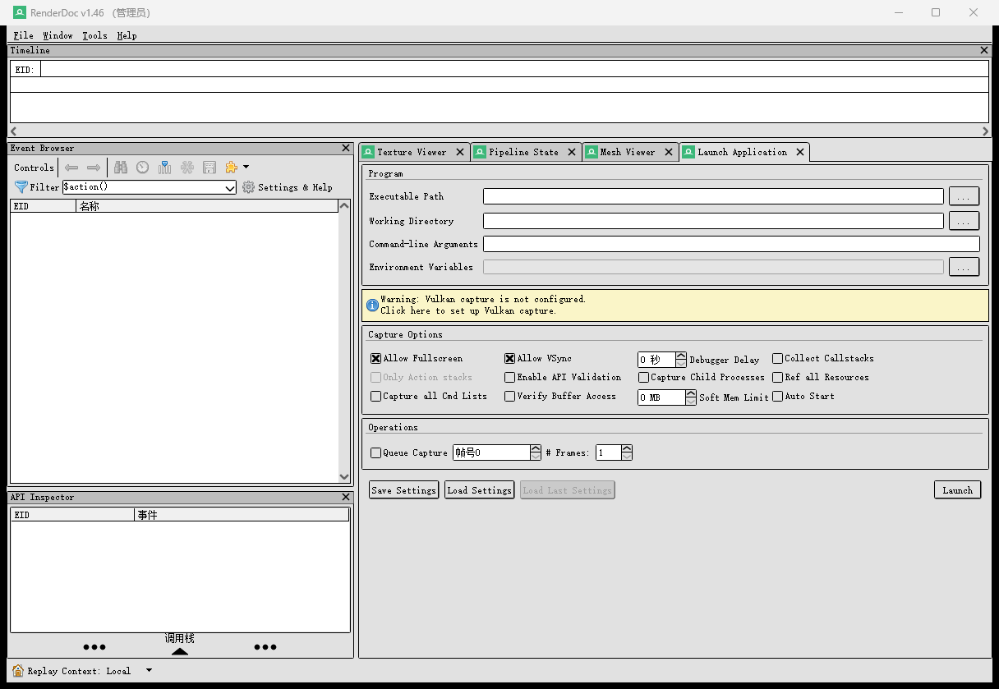
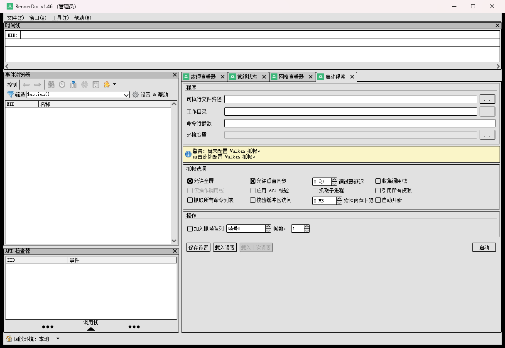

# RenderDoc 简体中文汉化

把 **RenderDoc 1.46** 的界面换成中文。功能与原版完全一致，抓帧、回放、抓到的数据都不受影响。

> Chinese localization for RenderDoc 1.46 — UI translated to Simplified Chinese.

|  |  |
|---|---|
| 支持的版本 | RenderDoc **1.46**（Windows x64） |
| 词条数 | 4115 条（RenderDoc 2499 + Qt 内建 1603 + 其余 13） |
| 中英切换 | 界面右上角导航条点击，或按 **F1** |

## 下载

到 [Releases](../../releases) 下载 **`RenderDoc-zh-CN-Full_v1.0.0.exe`**（约 80 MB）。

安装包**自带 RenderDoc 1.46 完整本体**，不需要事先安装 RenderDoc；
一路「下一步」装完就能用，界面直接是中文。

> RenderDoc 是 MIT 许可的自由软件，允许自由分发。它的版权与许可声明随包附带
> （装好后见安装目录下的 `LICENSE.rtf`）。

## 授权

本仓库有**两套许可**，别混：

| 覆盖范围 | 许可 |
|---|---|
| 词条译文（`dict/`）、工具脚本、文档 | **CC BY-SA 4.0** —— 可以用、可以改、也可以商用，但**改完的词条表必须以同样许可公开** |
| RenderDoc 本体 | **MIT** —— 版权归 Baldur Karlsson |

详见 [NOTICE.md](NOTICE.md)。

## 使用

- **启动**：照常双击 RenderDoc，界面默认中文
- **切换中英**：界面右上角导航条上的「中 / EN」，或者直接按 **F1**
- **关于**：导航条左边的「星空汉化」可以点开作者主页

## 截图

原版（英文）→ 汉化后：




## 词条表

界面文案全部在 [`dict/rd_zh.tsv`](dict/rd_zh.tsv)，UTF-8、三列 TAB 分隔：

```
context  <TAB>  source  <TAB>  translation
```

- `context=any` —— 通用词条，按原文匹配
- `context=lit` —— 供界面里直接写死的那部分文案使用，只在精确匹配时生效
- 其它 context —— Qt 自带对话框的词条（文件选择、消息框、快捷键修饰名等）

换行写成 `\n`（两个字符），和 Qt 的 `.ts` 一个规则。
想改译文直接改这个文件即可，**改完不用重启程序**，程序会自己重新读取。

`tools/extract_strings.py` 可以从 RenderDoc 源码里按 `lupdate` 的规则重新抽出全部
可翻译文案 —— 以后 RenderDoc 出新版本时，用它抽新词条再对着本表补译即可。

## 换版本

本汉化是针对 **RenderDoc 1.46** 做的。RenderDoc 升级后：

- 小版本升级：绝大部分词条仍然适用，界面里没翻到的地方会保持英文
- 大版本升级：建议用 `tools/extract_strings.py` 重新抽词条再来一遍

## 已知限制

- 少数**带参数的动态文案**（例如状态栏的「Replay Context: 本地」这类运行时拼接的句子），
  切回英文时句子里的参数部分可能仍保留中文，切回中文则完全正常。
- 译文按图形学惯例统一了术语（管线状态 / 描述符 / 着色器 / 网格块 / 绘制调用 …），
  如果你习惯别的叫法，改 `dict/rd_zh.tsv` 就行。

## 完全免费

本汉化为无偿公益汉化，完全免费分享，禁止任何形式的售卖。
如果你是付费购买的，请及时联系卖家申请退款。
如果觉得汉化对你有帮助，欢迎充电支持 UP，感谢大家的支持！

RenderDoc 版权归 Baldur Karlsson 所有，请支持正版。

## 星空汉化

B 站主页：https://space.bilibili.com/177308205

使用过程中遇到问题、或者发现哪里翻得不对，都欢迎来 B 站找我反馈！
